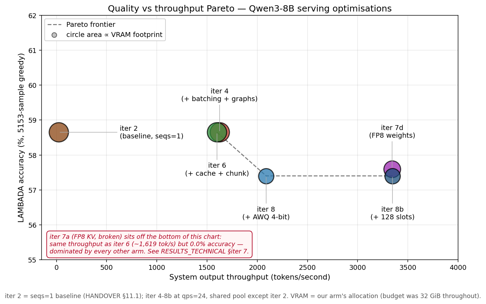
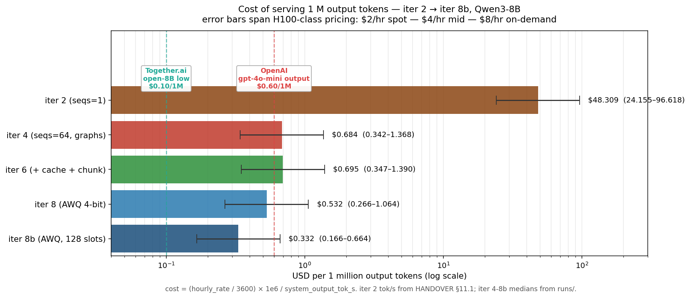
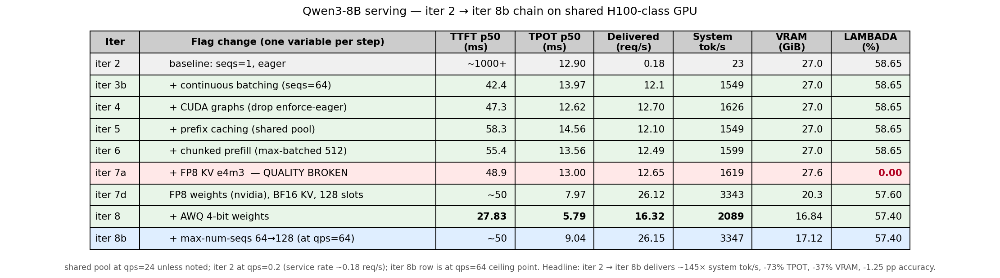
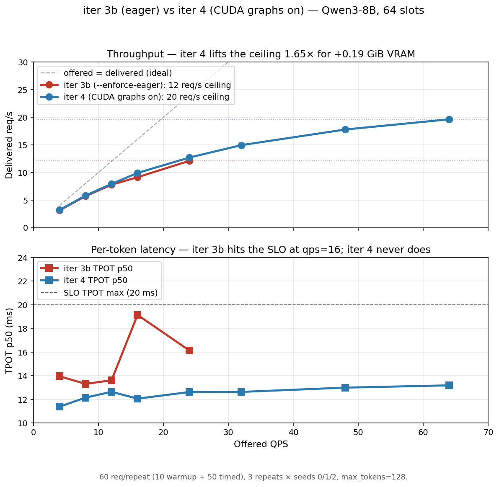
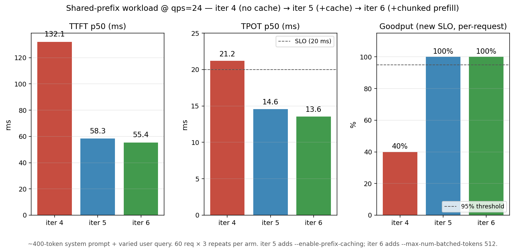

# LLM Serving — a measured study of vLLM optimisation on Qwen3-8B

A reproducible study of how fast and how cheaply an 8-billion-parameter LLM can be served **through a single engine (vLLM) on one RTX PRO 6000 Blackwell (`sm_120`)**, measured end-to-end with honest latency, throughput, VRAM and accuracy numbers for every optimisation step. Nine iterations are tried in order, each one a **single-flag change** on top of the last, so the measured delta is traceable to one decision. Engine comparison (SGLang, TensorRT-LLM) is out of scope; this is depth on one engine, not breadth across them.

**→ [Tech stack](#tech-stack)**

## Headline



**Ten flag changes, from a single-request floor (`--max-num-seqs 1 --enforce-eager`) to the final config, take Qwen3-8B from 23 to 3,347 output tokens per second** — about **145×** more throughput — at **-1.25 percentage points** of accuracy on LAMBADA last-word prediction (58.65 % → 57.40 %). VRAM footprint drops **-37 %** (27 → 17.1 GiB), per-token latency drops **-57 %** at saturation (21 → 9.0 ms TPOT). **Cost of serving 1 M output tokens drops from $48 to $0.33** at a $4/GPU-hour rental scenario — ~45 % cheaper than OpenAI gpt-4o-mini's output tier. That floor is not a default vLLM launch: default vLLM already batches and captures CUDA graphs.





Every row is one flag flip from the row above. Green = "no accuracy cost, free speedup". Red = iter 7a (FP8 KV without offline calibration — the model collapsed to 0 % accuracy). Blue = iter 8, the Pareto-optimal choice for throughput-sensitive serving. Full numbers and the reasoning for each row are in the two reports below.

## Results

- **[report/RESULTS_SUMMARY.md](report/RESULTS_SUMMARY.md)** — plain-language walkthrough with charts and analogies (start here)
- **[report/RESULTS_TECHNICAL.md](report/RESULTS_TECHNICAL.md)** — full tables, methodology, statistical treatment, per-iteration deltas, reproducibility commands

## The chain in one sentence per step

| | Change | What it bought |
|---|---|---|
| **iter 2** | baseline: `--max-num-seqs 1 --enforce-eager` | 0.18 req/s, 59.6 % accuracy — the single-concurrent-request floor |
| **iter 3b** | continuous batching: `--max-num-seqs 64` | 12 req/s ceiling (67× iter 2), same accuracy |
| **iter 4** | drop `--enforce-eager` (CUDA graphs on) | 20 req/s ceiling, -37 % TPOT at the saturation point |
| **iter 5** | add `--enable-prefix-caching` on a shared-prefix workload | -56 % TTFT, -31 % TPOT when the prefix repeats |
| **iter 6** | add `--max-num-batched-tokens 512` (chunked prefill) | -7 % TPOT on top of iter 5, reduces decode starvation under bursty load |
| **iter 7a** | `--kv-cache-dtype fp8_e4m3` (FP8 KV cache) | **BROKEN** — attention collapsed to 0 % accuracy; needs offline KV calibration not currently wired in |
| **iter 8** | `--quantization awq` + `Qwen/Qwen3-8B-AWQ` 4-bit weights | **+132 % output tok/s, -57 % TPOT, -38 % VRAM, -1.25 pp accuracy** |
| **iter 8b** | raise `--max-num-seqs 64 → 128` to spend iter 8's freed VRAM | **ceiling +33 % (19.6 → 26.2 req/s), TPOT at saturation -31 % (13.2 → 9.0 ms), accuracy unchanged** |
| **iter 7d** | swap to NVIDIA's `Qwen3-8B-FP8` (FP8 weights, BF16 KV, 128 slots) | **matches iter 8b throughput (26.1 req/s), -12 % TPOT (7.97 ms), +1.8 pp accuracy (57.60 % vs 55.80 %) at +3.2 GiB VRAM** |
| **iter 9** | accuracy harness (LAMBADA 5,153 samples) | the measurement tool that turned iter 7's smoke-test anecdote into a 0.0 % hard number |
| **iter 10** | Pareto figure + summary table | the two figures above |

## The two measurement points that matter most



**iter 3b → iter 4 moves the throughput ceiling from ~12 req/s to ~20 req/s** by letting the engine replay fused CUDA graphs instead of launching kernels one at a time. Costs: +30 s one-time startup, +0.19 GiB VRAM. Buys: 1.65× more delivered throughput at the ceiling, 37 % lower TPOT at the previous knee (qps=16).



**On a workload shaped like a chat API** (same 400-token system prompt + varied user query, 400 tokens of prefix shared across every request), **prefix caching + chunked prefill cut TPOT by 36 % and TTFT by 58 % at saturation**, lifting goodput from 40 % to 100 %. The gains compose cleanly — iter 5 does most of the work, iter 6 adds a 7 % polish on top.

## Quickstart

Prerequisites: a Linux host with an NVIDIA GPU and CUDA 13 drivers, Python 3.12+, ~30 GiB free disk for the model cache.

```bash
# 1. Copy the example, set LLMOPT_ROOT to a dedicated subdirectory you own, then install.
#    teardown.sh deletes that directory recursively. The scripts read these values with os.getenv.
cp .env.example .env
set -a; source .env; set +a
./scripts/remote/install.sh

# 2. Launch the engine (prints the VRAM budget plan, runs a smoke test, writes a pidfile)
$LLMOPT_ROOT/.venv/bin/python scripts/remote/serve.py \
  --root "$LLMOPT_ROOT" \
  --model Qwen/Qwen3-8B \
  --weights-gib 15.3 --budget-gib 32 --kv-pool-gib 10 \
  --max-num-seqs 64 --max-num-batched-tokens 512 --enable-prefix-caching

# 3. Run a performance bench against it (writes a Parquet of per-request rows + a summary JSON)
$LLMOPT_ROOT/.venv/bin/python scripts/remote/bench_vllm.py \
  --base-url http://127.0.0.1:18000 \
  --arm-id my-run --qps 24 --max-requests 60 --warmup 10 \
  --prompts-file samples/prompts_shared.txt --out ./runs

# 4. Run an accuracy pass (500 LAMBADA samples, ~6 s)
$LLMOPT_ROOT/.venv/bin/python scripts/remote/accuracy.py \
  --arm-id my-run-acc --limit 500 --out ./runs

# 5. Stop the engine cleanly
$LLMOPT_ROOT/.venv/bin/python scripts/remote/stop.py --root "$LLMOPT_ROOT"
```

Every number in both reports regenerates from the commands above with the flag variations documented per iteration in [report/RESULTS_TECHNICAL.md](report/RESULTS_TECHNICAL.md).

## Tech stack

| | |
|---|---|
| **Languages & runtime** | **Python 3.12** · **Bash** · **Linux** · **NVIDIA GPU** (RTX PRO 6000 Blackwell, **CUDA 13**, `sm_120`) |
| **LLM inference** | **vLLM 0.25** · **PyTorch** · **flashinfer 0.6** · **Hugging Face Transformers** · **Qwen3-8B** (BF16, AWQ, FP8 variants) · OpenAI-compatible **REST API** |
| **Quantization & optimisation** | **AWQ** 4-bit weights · **FP8** weights and KV cache · **continuous batching** · **CUDA graphs** · **prefix caching** · **chunked prefill** |
| **Performance benchmarking** | **async / asyncio** open-loop load generator · **httpx** streaming SSE client · **Poisson arrival** schedule · **TTFT / TPOT / ITL / E2E** with **p50 / p95 / p99** · **goodput** under SLO |
| **Data & analysis** | **PyArrow / Parquet** per-request rows · **pandas** · **matplotlib** · **Pareto** frontier analysis · cost-per-million-tokens modelling |
| **Accuracy evaluation** | **LAMBADA** last-word exact match, greedy decode, 5,153-sample test split |
| **Engineering practices** | **pytest** (183 tests, no GPU required) · **ruff** (strict) · **mypy** (strict) · **pyproject.toml** build · reproducible one-command ladder |
| **Systems / infra** | process lifecycle management · **atomic pidfile** (write + readback verify) · POSIX **process-group isolation** (`setsid`) for clean engine teardown |

## Repository layout

```
src/llmopt/              — the measurement instrument (183 tests, no GPU required)
scripts/remote/          — the CLI scripts that run on the GPU host (serve, stop, bench, accuracy)
samples/                 — committed prompt pools and LAMBADA test split
tests/                   — unit tests; marker-separated from the (currently empty) gpu tests
figures/                 — publication PNGs
runs/                    — one directory per bench + accuracy run (per-request Parquet + summary JSON)
report/                  — the two write-up documents linked above
```
