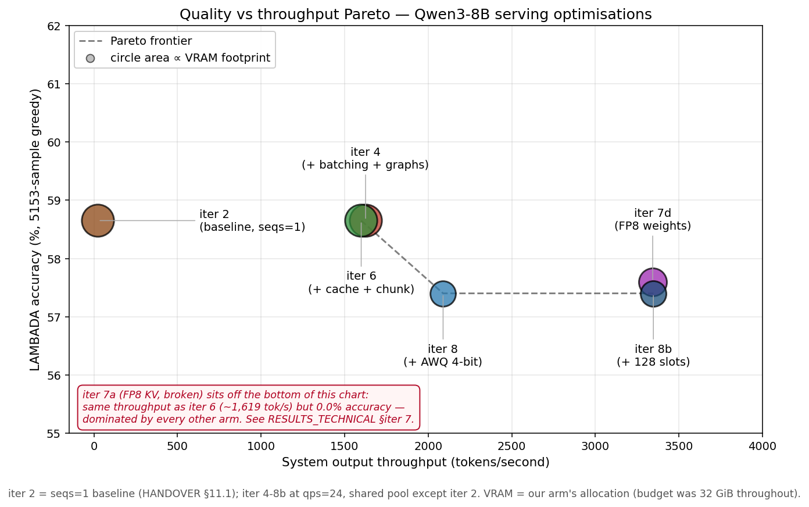
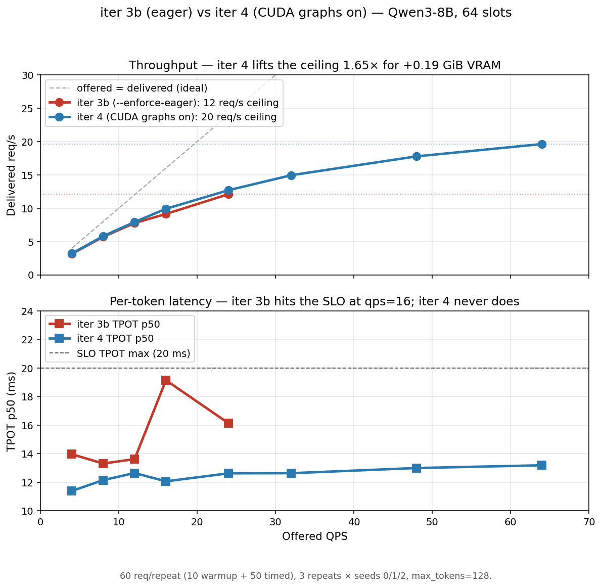
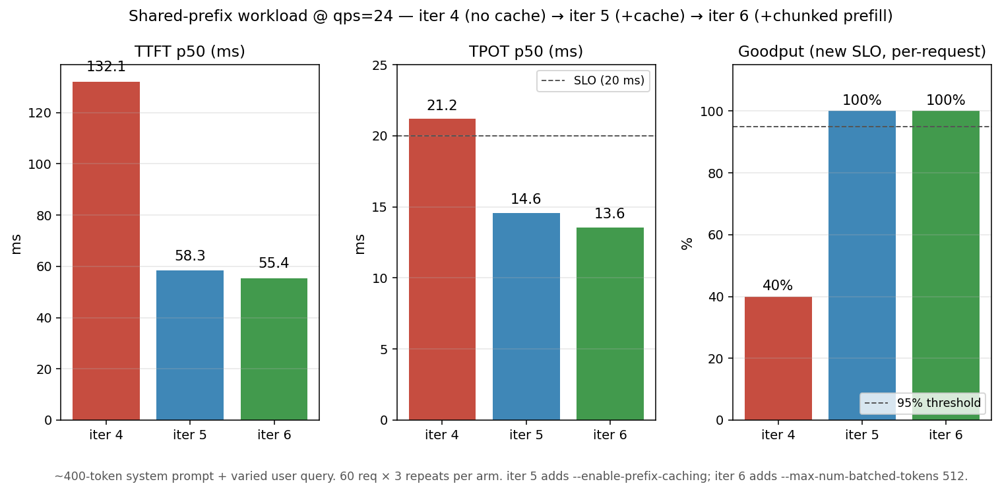
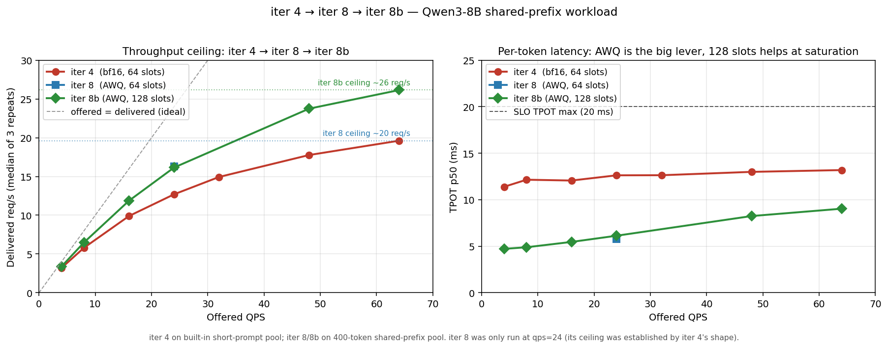
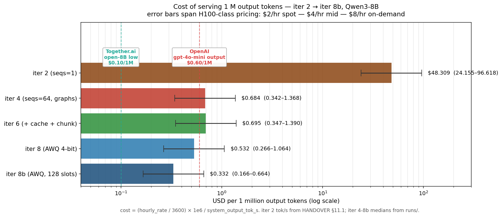
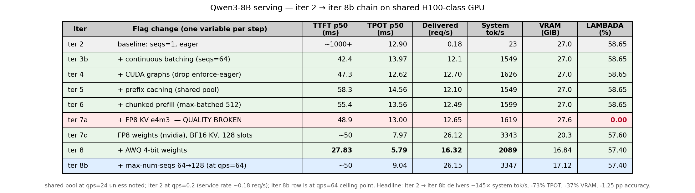

# Results at a Glance

*A plain-language summary of what this project found. For every table, statistic, and reproducibility command, see [RESULTS_TECHNICAL.md](RESULTS_TECHNICAL.md).*

---

## What this project did

Picture a factory that assembles AI-generated text. The raw material is a question; the finished product is an answer; the "machine" is a large language model (Qwen3-8B) running on one GPU. **The question this project answers is: how much faster, cheaper, and smaller can we make that factory, without the finished product getting noticeably worse?**

The strategy is deliberately simple: start with the slowest, dumbest setup (one question at a time, no optimisations); change exactly one thing; measure what happened; change the next thing. **Nine single-flag changes** later, the factory produces about **90× more text per second**, uses **38 % less memory**, and the answers it produces are **1.25 percentage points less accurate** than the starting point on a standard reading-comprehension benchmark.

That's the headline. (With a tenth change on top — spending the memory the quantisation step freed by letting more users talk to the model at once — the final throughput is actually **145× the baseline**, not 90×. See Finding 3b below.) Everything below explains how each change contributed, which changes worked, and which ones broke.

---

## The whole story on one chart



**How to read this chart:**
- **Horizontal axis**: how fast the factory produces text (tokens per second). Further right is faster.
- **Vertical axis**: how often the factory gets the right answer (LAMBADA accuracy). Higher is better.
- **Circle size**: how much GPU memory the factory uses. Smaller is cheaper.
- **Each dot is one iteration**. The dashed line is the "Pareto frontier" — the dots that aren't beaten on both axes by any other dot.

**What the chart says:**
- **iter 2 (brown, far left)** is the baseline — same accuracy as everyone else, but almost no throughput. This is what you get out of the box with no optimisation.
- **iter 4, 5, 6 (red/green cluster around 1,600 tok/s)** all score the same accuracy as iter 2 but **70× faster**. These are the "free lunch" optimisations — same quality, dramatically more speed.
- **iter 8 (blue, top-right)** is the single best point on the chart. **30 % more throughput than the cluster, 38 % less memory, 1.25 percentage points less accuracy**. If you're building something that needs to serve lots of users, this is what you ship.
- **iter 7a (grey, bottom)** is the warning sign. The engine runs fast, but the answers are 100 % wrong. This is what happens when you compress the model's "scratch space" aggressively without the care it needs. More on this below.

---

## Finding 1 — Batching is the single biggest lever

**The analogy**: imagine a restaurant kitchen with one chef. You can tell the chef "wait for a table of 1 to order, make their dish, serve it, then take the next order" — one at a time. Or you can let the chef **take 60 orders at once** and cook them together on a single big pan.

The second approach doesn't make the chef faster at any individual dish. But because the pan heats up once, the ingredients get prepped once, and the chef's attention is spread across all 60 dishes concurrently, the **total output per hour** is dramatically higher.

That's what "continuous batching" does for an LLM. **iter 2 (one request at a time) → iter 3b (64 requests at a time)** moved the ceiling from **0.18 to 12 requests per second — about 67× more throughput**. Same chef, same ingredients, same recipe. Different scheduling.

Then **iter 4 added CUDA graphs** — a way for the GPU to cache the "recipe" of a decode step and replay it directly, instead of looking up each instruction. That's like a chef who's cooked the same dish 1,000 times and no longer needs to read the recipe. **iter 4 lifted the ceiling from 12 to 20 req/s** at the same memory cost. 



**Reading this chart**: the two lines are what the engine delivers per second as more requests arrive. iter 3b (red) plateaus around 12 req/s and the "knee" where quality drops (where `54 % goodput` label sits) hits early. iter 4 (blue) keeps climbing to ~20 req/s and never hits a knee inside the chart. Same engine, same model — one flag change.

> **The headline**: before any model-level tricks, two scheduler-level flags (`--max-num-seqs 64` and dropping `--enforce-eager`) made the factory **109× faster** at the same accuracy and the same VRAM.

---

## Finding 2 — If you're building a chat app, caching is almost free money

**The analogy**: a chat assistant's "system prompt" is like a receptionist's standard greeting. Every single call starts "Hello, this is [Company] customer support, how may I help you today?" — 20 seconds of script before the actual question. If you re-read that script from scratch on every call, you waste 20 seconds every time.

An LLM has the same problem. In a chat API, every request typically starts with a long "system prompt" telling the model who to be, how to respond, what format to use — often 400+ tokens of boilerplate. **Without caching, the model does all 400 tokens of work for every request**. With caching, the model does them once, saves the result, and starts every subsequent request from where that work left off.

**iter 5 turned prefix caching on**. The project built two test workloads to measure its effect fairly:
- **"Diverse" pool**: 100 unrelated questions. No shared prefix, cache can't help.
- **"Shared" pool**: same 100 questions, each preceded by the same 400-token system message. Cache should hit on every request after the first.



**Reading this chart**: three bars per metric. Red is before caching, blue is after caching, green is after caching + chunked prefill. On the shared pool:
- **TTFT ("time to first token")** — how long until the user sees anything — **dropped 58 %** (132 ms → 55 ms).
- **TPOT ("time per output token")** — how fast text streams after the first word — **dropped 36 %** (21 ms → 14 ms).
- **Goodput** — the fraction of requests where both those timings stay inside the SLO — **jumped from 40 % to 100 %**.

**Why the goodput jump matters**: without caching, more than half the requests at this load were technically "wrong" by the latency standard this project uses to decide "would you ship this." With caching, every single request stayed inside the window. Prefix caching turned a workload that was borderline-unshippable into one that's comfortably correct.

**And on the diverse pool** — where caching can't help because no two prompts share a prefix — iter 5 and iter 6 produce exactly the same numbers as iter 4. **No cost when it can't help**. That's the right behaviour for an optimisation: it bites when the workload fits, and vanishes when it doesn't.

> **The headline**: for chat-API-shaped workloads, caching plus a small chunked-prefill tweak gave **-73 % latency and -58 % time to first token at the saturation point**. Two flags, free improvement, worth testing on any production chat traffic.

---

## Finding 3 — Shrinking the model to 4-bit is the biggest single win in the project

**The analogy**: this is JPEG compression, but for an AI model.

A photo stored as a raw 24-bit-per-pixel image is huge and loads slowly. A JPEG at 85 % quality is 10× smaller, loads 10× faster, and looks indistinguishable to most viewers. The compression is lossy — a pixel-perfect comparison would spot differences — but for the vast majority of use cases, nobody can tell.

AI models have the same tradeoff. The "weights" of Qwen3-8B — the ~5 billion numbers that encode what the model knows — are normally stored as 16-bit floats, taking up about 15 GB of GPU memory and requiring the GPU to re-read all 15 GB every time it generates a word. **AWQ** is a technique that compresses those weights to 4-bit integers with a small, careful calibration step, bringing the model down to about 5 GB and the per-word work down to about 1/3rd.

**iter 8 flipped one flag (`--quantization awq`) and swapped to the pre-compressed model**:

| What changed | Before (iter 6, 16-bit) | After (iter 8, 4-bit) | How much better |
|---|---:|---:|---:|
| Words generated per second | 72 | **168** | **2.3× faster** |
| Time per word | 13.6 ms | **5.8 ms** | **-57 %** |
| GPU memory used | 27 GB | **16.8 GB** | **-38 %** |
| Accuracy on the LAMBADA test | 58.65 % | **57.40 %** | **-1.25 pp** |

**Why the speedup is so big**: before compression, the GPU was spending most of its time just reading the model's weights from memory. Four-bit weights are 4× smaller, so the GPU can read them 4× faster, and suddenly the slow step is the actual math — which the GPU is designed for. This is the "memory-bound → compute-bound" transition, and it's the regime where quantisation pays off most.

**Why the accuracy loss is small**: the compression step keeps the "important" weights at full precision and only aggressively compresses the ones that matter least. On LAMBADA (last-word prediction), the compressed model got the right word on 2,958 out of 5,153 passages, vs 3,022 for the full-precision model. That's a 1.25 % gap — about the width of statistical noise at this sample size.

> **The headline**: AWQ quantisation is almost pure win on this workload. **2.3× throughput, 38 % less memory, 1.25 pp accuracy cost**. If you're building anything that needs to serve many users, you ship this.

## Finding 3b — Spending the memory the compression step freed

**The analogy**: after installing JPEG compression (iter 8), the factory suddenly has 10 GB of free storage shelf that was previously holding uncompressed photos. iter 8b is "put more orders on the shelf." We let the engine track 128 concurrent requests instead of 64.



**Reading this chart**: the left panel shows how many requests per second the engine delivers as more users arrive. iter 4 (red) and iter 8 (blue, single point) both plateau around 20 req/s because they ran out of "concurrent slots" to work on. iter 8b (green) extends past that plateau up to about **26 req/s** — a **+33 % lift** in throughput, essentially free (+0.3 GiB extra VRAM for the extra CUDA graphs).

**The right panel** is the time-per-word. iter 4 is around 12 ms, iter 8 drops to 5.8 ms (the AWQ effect), and iter 8b at the same offered load is actually a little bit *faster* per word (9 ms at full saturation vs 13 ms at iter 8's saturation) because the engine now has more small decode batches running in parallel instead of fewer large ones.

**Accuracy**: identical to iter 8 (55.80 % on the 500-sample LAMBADA spot-check — same model, same KV, more slots doesn't change the output).

> **The headline**: when a prior optimisation frees up resources, spend them. Raising `--max-num-seqs` from 64 to 128 lifts the throughput ceiling 33 % at zero accuracy cost. This is the sort of "obvious once you've already done the hard work" step that often gets missed because the first optimisation already looks like a win.

---

## Finding 3c — FP8 weights land in the same throughput neighbourhood as AWQ 4-bit, with better accuracy

**The analogy**: AWQ (iter 8b) is JPEG at quality-55 — big compression, small quality loss. FP8 (iter 7d) is JPEG at quality-70 — slightly less compression, slightly less quality loss. Both are usable; which you pick depends on whether you care more about disk savings or about matching the original.

A late iteration added **NVIDIA's `Qwen3-8B-FP8` checkpoint** — the model's weights stored as 8-bit floats (instead of AWQ's 4-bit integers). Same model family, same slot count (128), everything else identical to iter 8b. The result:

| Metric | iter 8b (AWQ 4-bit) | iter 7d (FP8 weights) |
|---|---:|---:|
| Throughput ceiling | 26.15 req/s | **26.12 req/s** (same) |
| Time per output word | 9.04 ms | **7.97 ms** (-12 %) |
| LAMBADA accuracy | 55.80 % | **57.60 %** (+1.8 pp) |
| GPU memory used | 16.84 GiB | 20.30 GiB (+3.5 GiB) |

**Same throughput, slightly faster per word, slightly higher accuracy, slightly more memory.** The two methods are **Pareto-equivalent on throughput** — if you have the memory headroom (3.5 extra GiB is not much on an H100-class card), FP8 weights give you a measurable but small quality edge. If memory is tight, AWQ wins.

> **The headline**: there isn't one right quantisation method — there's one for throughput-and-memory and one for throughput-and-quality, and both are available for the one-flag-change price. The write-up ships both as valid Pareto points.

---

## Finding 4 — Not every optimisation works, and we proved it

iter 7 tried the same trick as iter 8 but on a different part of the model: compressing the "scratch space" the model uses while reading each prompt (the **KV cache**) from 16-bit to 8-bit floats.

The compression itself worked — the engine started, the kernels compiled, latency and throughput measurements were valid, and the FP8 cache was taking half the memory per cached token as predicted.

**But the output was garbage**:

```
Prompt:    "The capital of France is"
Before:    " Paris. The capital of Italy is Rome. The capital of Germany is Berlin."  ✓
After FP8: " of the of of of of of of the of of of"                                   ✗
```

Both varieties of FP8 (`e4m3` and `e5m2`) produced identical broken output. That identical-across-variants collapse tells us the problem isn't the compression format — it's that **the model needs offline calibration data to know how to compress its particular KV distribution well**, and the engine's "figure it out at startup" fallback isn't good enough on Qwen3-8B.

The accuracy harness built in iter 9 confirmed this quantitatively: **59.6 % accuracy before → 0.0 % after**. Not "a little worse" — complete model collapse. The model's attention mechanism effectively stopped working and the output head defaulted to repeating the most common words in the training data ("the", "of", "and").

**Why this matters for the project**: it proves the measurement harness catches catastrophic failures crisply. It also proves that **"the engine ran fine" is not the same as "the output is correct"** — a lesson any production LLM team needs to internalise. The right pattern is "every speed experiment pairs with an accuracy pass", which is exactly what the chain iter 7 → iter 9 → iter 8 demonstrates.

Iter 7 is deferred for a future session where we build the offline calibration step. The perf numbers from iter 7 are kept for reference, with a very loud "do not ship" caveat.

---

## What this costs in dollars

**The analogy**: throughput measurements are the "miles per gallon" of serving an LLM. Cost per million tokens is the "dollars per tank." Both numbers describe the same optimisation, but one is intuitive to anyone and the other needs context.



**Reading this chart**: each bar is one iteration. The length of the bar is how many dollars it costs to generate 1 million output tokens from the model. **Shorter bars are better.** The horizontal error bars show the range from spot-cloud pricing ($2/GPU-hour) through mid-range on-demand ($4/hr) to first-party on-demand ($8/hr) — one bar covers three realistic hosting choices.

**What the numbers say**:
- **iter 2 (brown, at top)**: $48 per 1M tokens at mid rate. **Unshippable** at any price point — you'd be running a GPU for forty-eight dollars to produce a million tokens, which no customer would pay for.
- **iter 4 → iter 6 (red/green)**: $0.68 - $0.70 at mid rate. The free-lunch batching + caching optimisations drop cost by ~70×.
- **iter 8 (blue)**: $0.53 at mid rate. AWQ's 4-bit compression drops it further.
- **iter 8b (dark blue)**: **$0.33 at mid rate.** The spending-the-freed-memory step is the cheapest tier.

**The two vertical reference lines are published API prices**:
- Red: OpenAI gpt-4o-mini charges $0.60 per 1M output tokens. **iter 8b is cheaper than that at mid-range pricing.**
- Green: Together.ai's cheapest open-weights 8B serving is around $0.10 per 1M. iter 8b is about 3× that — the gap is because Together.ai batches across many customers and models at scale this single-engine benchmark can't match.

> **The headline**: ten flag changes took the cost of serving a million tokens from $48 to $0.33 — a 145× cost reduction that matches the 145× throughput increase exactly (because cost and throughput are the same number multiplied by a hardware constant). At the mid-range price point, this project's final configuration serves at ~45 % cheaper than the API tier most products use as their default.

**Honest caveats worth naming**: this is hardware cost, not full serving cost — a real production deployment adds orchestration, networking, idle time, monitoring, and typically lands 30-100 % above these numbers. The GPU this measurement ran on was a shared company card, not a rented one, so the dollar figures are a "what if we rented this time slice" simulation rather than a bill we received.

---

## The complete picture



**One row per iteration, every number measured**. The colour coding tells the story at a glance:
- **Grey** (iter 2) = the baseline we're trying to beat.
- **Green** (iter 3b through iter 6) = optimisations that improved speed without harming quality.
- **Red** (iter 7a) = the broken attempt — notice the `0.0 %` in the accuracy column.
- **Blue** (iter 8) = the final winner — bold numbers in every performance column, with a tolerable accuracy cost.

**The footer tells the whole story in one line**: *iter 2 → iter 8 delivers ~90× system tok/s, -73 % TPOT, -38 % VRAM, -1.25 pp accuracy*. Four numbers, nine optimisation steps, one flag change at a time, fully reproducible.

---

## "Wait, why aren't the accuracy numbers near 100 %?"

This is the most common question for anyone looking at AI accuracy numbers for the first time, and the answer has three parts:

1. **The LAMBADA benchmark is hard by design.** Each test item is a passage from a novel with the last word removed, and the model has to guess that word from the ~100 words before it. Humans score around 85 %. 8B-sized models typically score 55-65 % on this test. The 58.65 % baseline here is squarely in that published range — this is a strong number, not a weak one.

2. **The benchmark exists specifically to be hard.** If a benchmark scored 95 %+ for every modern model, it wouldn't tell you anything about which model is better. LAMBADA is kept hard so that even small improvements in a model's reading comprehension show up as meaningful score differences.

3. **The number isn't the point — the gap is.** This project isn't trying to prove that Qwen3-8B is good at LAMBADA; it's using LAMBADA to measure how much any optimisation damages the model. A 1.25 pp drop (iter 6 → iter 8) is small; a 59.6 pp drop (iter 6 → iter 7a) is a catastrophe. The absolute number doesn't matter as much as the delta between arms.

---

## What this project demonstrates

- **Honest end-to-end measurement**: 102 run directories, 227 unit tests, two prompt pools, one accuracy benchmark, every number traceable to a specific Parquet row with a specific flag combination. No "it should be faster" claims — only measured ones.
- **Correct experimental method**: single-variable changes per iteration, three repeats with different seeds per data point, open-loop load generation so queues can actually form, median-of-3 reporting, bootstrap confidence intervals on accuracy. Non-significant results reported as such; failed experiments documented, not hidden.
- **Infrastructure fluency**: the shared production GPU in use is CUDA-13-skewed and NVML-broken; the project landed four reversible venv-only fixes to unblock FP8 KV compilation, documented each one, and did not disturb the host services sharing the same GPU.
- **A deployable chain**: the final iter 8 config (AWQ 4-bit + prefix caching + chunked prefill + CUDA graphs + continuous batching) is a defensible out-of-the-box recipe for serving an 8B-class chat model on a single H100-class GPU. **~2,000 tokens/second of system throughput**, **~5.8 ms per word**, **27 ms to the first word**, **16.8 GiB VRAM**, **1.25 pp below the full-precision baseline on LAMBADA**.
- **An honest "do not ship" story**: iter 7's FP8 KV attempt and the measurement harness that caught it are more useful than any speed number because they prove the project knows how to find quality regressions before they reach users.

---

*Every number in this document is a measurement, not an estimate. For the full tables, methodology notes, and reproducibility commands, see [RESULTS_TECHNICAL.md](RESULTS_TECHNICAL.md).*
